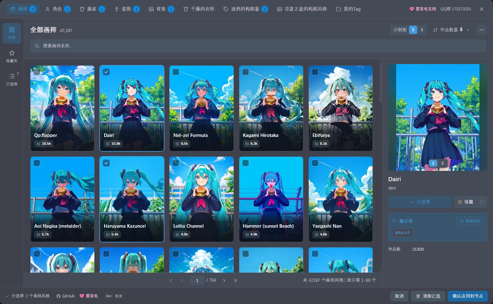
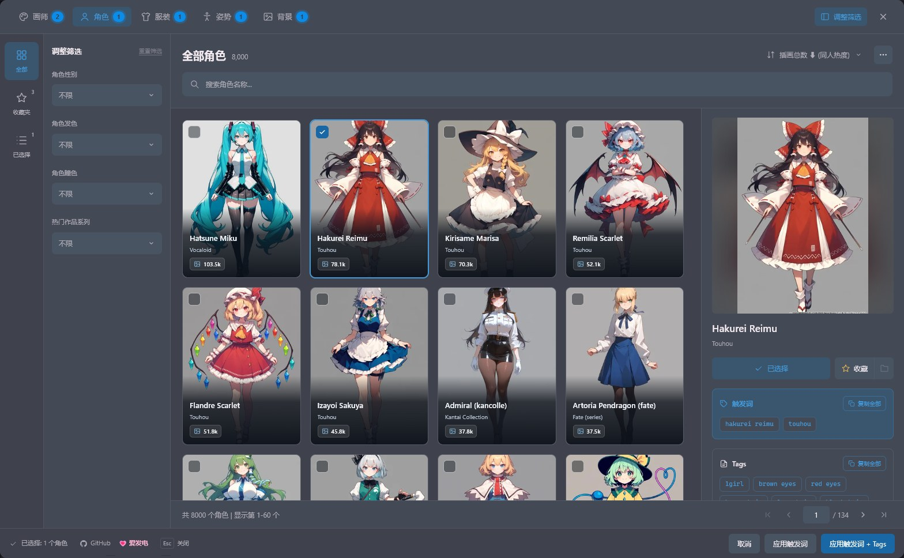
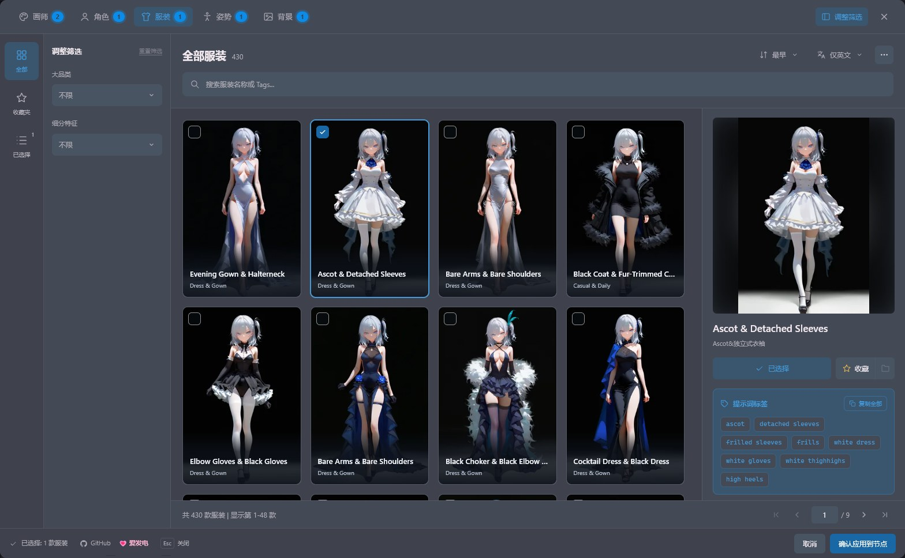
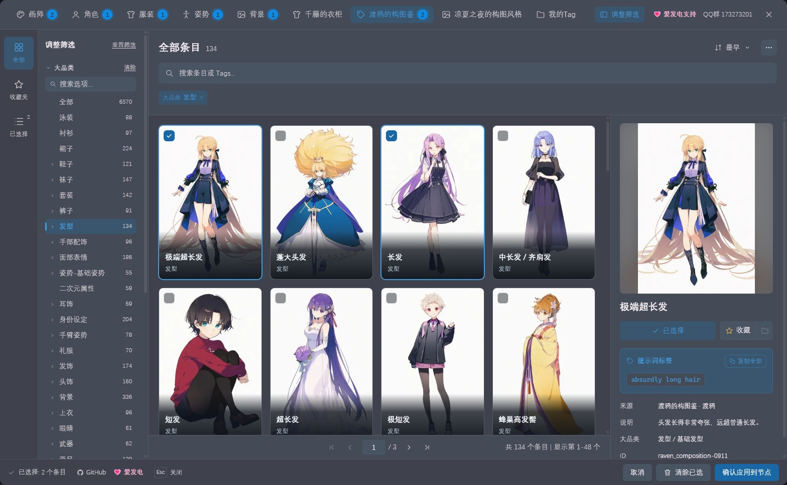
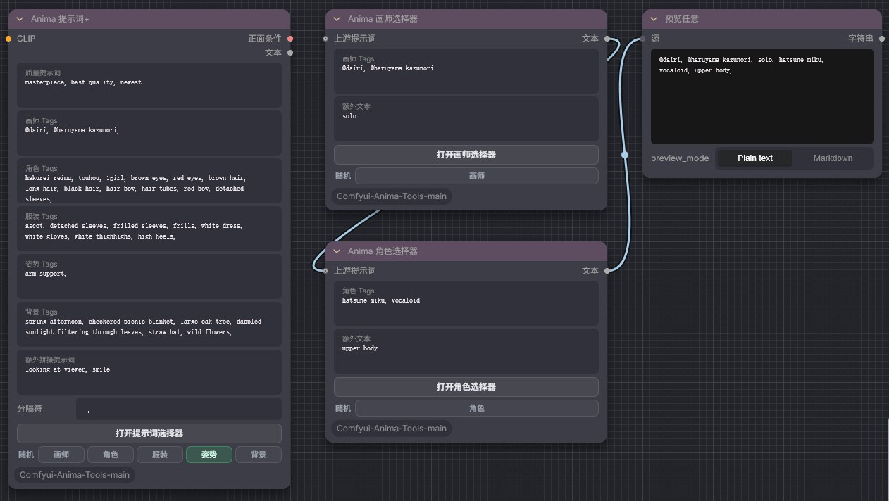
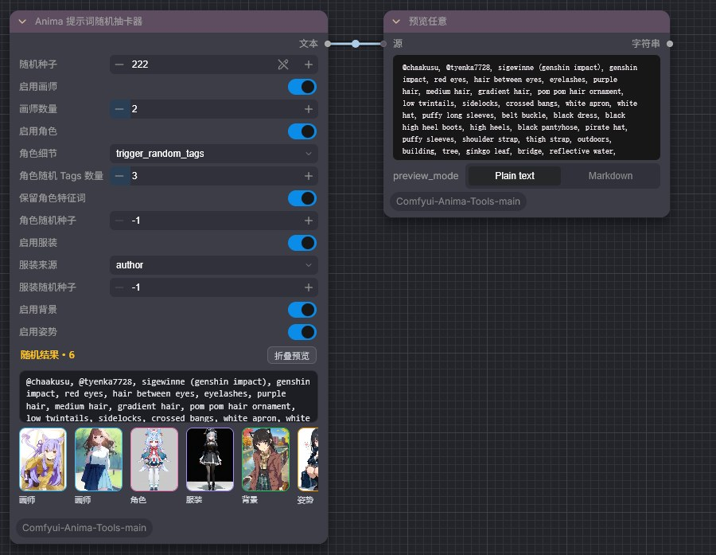
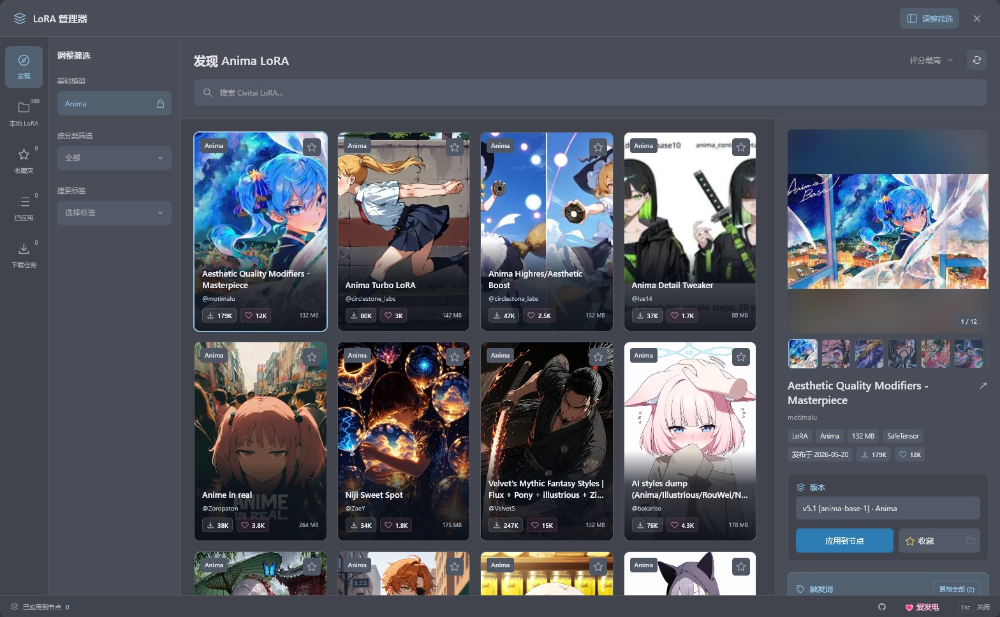

<div align="center">

# Anima-Tools

**为 Anima 模型准备的 ComfyUI 提示词工具箱**

可视化挑选画师、角色、服装、姿势、背景与社区 Tag 库 · 自建我的Tag · 一键随机抽卡 · 发现、下载并加载 Anima LoRA

<p>
  
  
  
  
  
  
</p>

<sub>A ComfyUI toolkit for the Anima model: visual pickers for 42,197 artists, 8,000 characters, outfits, poses and backgrounds, three community tag libraries (6,759 entries), a personal My Tags library, a random prompt draw node, and an Anima LoRA manager. The UI follows ComfyUI's language setting (Chinese / English).</sub>



</div>

## 亮点

| 功能 | 说明 |
| --- | --- |
| 🎨 **一个弹窗挑全部提示词** | 画师 **42,197**、角色 **8,000**、服装 **430**、姿势 **297**、背景 **1,087**，顶部标签页切换，角标显示每类已选数量，选好的内容写进打开它的那个输入框 |
| 📚 **社区 Tag 库 + 我的Tag** | 新增三个社区作者授权的 Tag 库共 **6,759** 条：千藤的衣柜 **125**、渡鸦的构图鉴 **6,570**、凉夏之夜的构图风格 **64**；还能在「我的Tag」里建自己的分类和条目，带封面，更新插件不丢失 |
| 🎲 **随机抽卡** | 运行时从全量数据里随机抽画师、角色、服装、背景和姿势，固定种子可复现，结果带缩略图预览 |
| 🧩 **Anima LoRA 管理器** | 在 ComfyUI 内搜索 Civitai 上的 Anima LoRA，下载、收藏、排序后直接叠加到模型上 |
| 🖼️ **Danbooru 随机图 + 标签** | 随机抽一张 Danbooru 静态图，同时输出按 Anima 写法整理好的标签 |
| 🪶 **零依赖** | 不需要 `pip install` 任何第三方库，界面跟随 ComfyUI 的明暗主题与语言 |

## 安装

**ComfyUI Manager（推荐）**：打开 Manager → Custom Nodes Manager，搜索 `Anima Tools`，安装后重启 ComfyUI。

**手动安装**：

```bash
cd ComfyUI/custom_nodes
git clone https://github.com/nregret/Comfyui-Anima-Tools.git
```

重启 ComfyUI 后，节点位于 `AnimaArt` 与 `Anima/Danbooru` 分类下。

## 快速上手

1. 添加 **Anima 提示词+** 节点，接入 CLIP，把 `正面条件` 接到采样器。
2. 点击任意输入框右上角的 **选择**，在画师、角色、服装、姿势、背景和社区 Tag 库之间切换挑选，点 **确认应用到节点**，选中的 Tags 会写进这个框。
3. 想每次出图都换点花样？点输入框标题栏的随机图标，勾选运行时要随机的分类，或者直接换成 **Anima 提示词随机抽卡器**。

## 功能展示

### 🎨 提示词选择器

画师、角色、服装、姿势、背景、三个社区 Tag 库和我的Tag 共用一个弹窗：左侧是「全部 / 收藏夹 / 已选择」和筛选面板，分类、特征等选项直接列出、点一下就筛选，每组可以折叠，选项多时带搜索；社区 Tag 库按原作者的分类显示成可展开的分类树。右侧详情页显示大图和提示词（点击即可复制）。切换分类时已选内容会保留，下次打开时回到上次使用的分类。

<table>
  <tr>
    <td width="50%"></td>
    <td width="50%"></td>
  </tr>
  <tr>
    <td align="center"><sub>角色：按性别、发色、瞳色、作品系列筛选，可只应用触发词，也可连同官方特征 Tags 一起应用</sub></td>
    <td align="center"><sub>服装：按大品类与细分特征筛选，名称支持中英双语</sub></td>
  </tr>
</table>

- **画师**：按作品数或字母排序，输出统一整理为 `@画师名`；每位画师有两张用 Anima 基础模型生成的样图，详情里可以切换。
- **收藏与自定义**：收藏可以分组和加备注；服装、姿势、背景还能添加自己的条目。
- **批量操作**：底部「清除已选」一键清空当前分类的已选内容，右上角「更多」菜单可以复制已选，分页栏可以输入页码直达。

#### 社区 Tag 库

「Anima 提示词」和「Anima 提示词+」的选择器里，另有三个社区作者授权收录的 Tag 库，各占一个标签页：

| 标签页 | 作者 | 条目 | 内容 |
| --- | --- | ---: | --- |
| 千藤的衣柜 | 叫我千藤就好了 | 125 | 整套服装搭配，附风格说明 |
| 渡鸦的构图鉴 | 渡鸦 | 6,570 | 服装、配饰、姿势、表情、背景、画风、角色等 Tag 词典，按原作者分类筛选 |
| 凉夏之夜的构图风格 | 凉夏之夜 | 64 | 带镜头与权重的完整场景描述 |



数据整理自 [quicktagcloud](https://novelai.quicktagcloud.com/)，由 `tools/import_codex_libraries.py` 生成。下划线已转成空格，括号已转义，原有的 `(tag:权重)` 保留。渡鸦构图鉴中的「秋季课堂」使用 NovelAI 专有语法，没有收录。

#### 我的Tag

同一个选择器的最后一个标签页是自己的 Tag 库。在左侧「调整筛选」里点「+」新建大分类，鼠标移到分类上可以新建子分类、新建条目、重命名或删除；条目在右侧面板里填写名称、Tag 内容（英文或中文逗号分隔，保存时统一整理成 `, `）并上传封面（支持点击、拖入或粘贴，自动压缩成 WebP）。内容保存在 `ComfyUI/user/anima_tools_my_tags/`（`my_tags.json` 和 `covers/` 封面），更新或重装插件都不会丢失，具体路径可以点工具栏的 ⓘ 查看。欢迎把自己的 Tag 库分享到 QQ 群 173273201，一起共建开源社区。

### 🧩 提示词节点



- **Anima 提示词 / Anima 提示词+**：由若干输入框从上到下拼接，自动去掉多余的逗号和空格。每个框右上角的 **选择** 打开完整的选择器，选中的 Tags 写进这个框，手打的内容会保留；标题栏右侧依次是禁用、随机、清空、复制、选择和删除按钮：禁用让这个框变灰并暂时不参与拼接输出，再点一次恢复，框里的文字原样保留；清空会清掉框里的文字和已选记录，复制把框里的文字复制到剪贴板。新建节点只有一个框，用底部「添加输入框」按需增加；拖动框左上角的手柄调整顺序，点标题重命名，框高随内容自动伸缩。每个框左侧都有自己的连接点，可以把其他节点的文本直接连到框上；连上后这个框改用连进来的文本，和原生输入框被连接时一样，断开后恢复原来的内容（被禁用的框即使连了线也不参与输出）。提示词+ 直接用 CLIP 编码并输出条件。
- **五个单类选择器**（画师 / 角色 / 服装 / 背景 / 姿势）：每个只管一类，输出顺序为 **上游文本 → 所选 Tags → 额外文本**，可以像上图一样串成一条链。
- **随机**：提示词节点在输入框标题栏的随机图标里勾选分类，每次运行从这些分类各抽一项写进这个框；单类选择器在节点底部「随机」一行打开。

### 🎲 提示词随机抽卡器



- 输出顺序固定为 **画师 → 角色 → 服装 → 背景 → 姿势**，每类都可以单独关闭。
- 角色有三种细节模式：只要触发词、触发词 + 全部特征 Tags、触发词 + 随机抽取的部分 Tags。发色、瞳色等身份特征可以固定跟在触发词后面，性别词始终不带，方便性转。
- 服装可以来自内置图库、Danbooru 服装标签组（上装 + 下装 / 制服 / 传统服饰三选一，再配饰品、袜子、鞋子）或其他角色的服装 Tags，也可以每次随机挑一种来源。
- 角色和服装可以单独设置种子：锁定一项，另一项继续抽。
- 每次的结果和缩略图显示在节点上，并随工作流和图片元数据一起保存。

### 🧩 Anima LoRA 管理器



**Anima 多 LoRA 加载器** 节点上点 **打开 LoRA 管理器**：

- **发现**：只搜索 Civitai 上基础模型为 Anima 的 LoRA，支持分类、标签筛选和排序。
- **本地 LoRA / 收藏夹 / 已应用 / 下载任务**：本地 LoRA 可按基础模型筛选；已应用的 LoRA 可以排序；下载在后台排队进行。
- 节点面板上可以调整每个 LoRA 的强度、启用或移除，并能复制触发词。

LoRA 只从 ComfyUI 已登记的 `loras` 目录加载，下载保存到第一个 `loras` 目录下的 `基础模型/分类/` 子文件夹。要用其他磁盘，请先在 `extra_model_paths.yaml` 里把它登记为 `loras` 路径。Civitai 密钥只保存在服务端，不会回传到浏览器，下载跳转也不带认证头。

这个管理器移植自 [CivitaiManager](https://github.com/nregret/CivitaiManager)，使用独立的接口路径、样式前缀和数据目录 `user/anima_tools_lora_manager/`，两者可以同时安装。

### 🖼️ Danbooru 随机图 + 标签

**Anima Danbooru Random Image** 按 `query_tags` 从 Danbooru 随机抽一张静态图，输出图片和按 Anima 写法整理好的标签（下划线转空格、小写、去重、画师加 `@`）。标签按画师 / 角色 / 作品 / 通用分组输出，`prompt` 输出是拼好的整串，可以直接接 `CLIPTextEncode`。

## 节点一览

| 节点 | 中文名 | 用途 | 输出 |
| --- | --- | --- | --- |
| Anima Prompt | Anima 提示词 | 可增减的输入框，每个框都能打开选择器 | `text` |
| Anima Prompt Plus | Anima 提示词+ | 同上，并直接用 CLIP 编码 | `positive`、`text` |
| Anima Artist / Character / Clothing / Background / Pose Selector | Anima 画师 / 角色 / 服装 / 背景 / 姿势选择器 | 单类选择器，可串联 | `text` |
| Anima Prompt Random Draw | Anima 提示词随机抽卡器 | 运行时随机组合提示词 | `text` |
| Anima Multi LoRA Loader | Anima 多 LoRA 加载器 | LoRA 管理器 + 多 LoRA 叠加 | `MODEL` |
| Anima Danbooru Random Image | — | 随机 Danbooru 图 + 分组标签 | `image`、`artist`、`character`、`copyright`、`general`、`prompt`、`meta` |

<details>
<summary><b>Anima 提示词 / 提示词+ 参数</b></summary>

- `prompt_boxes`：输入框列表（JSON），由节点界面维护，每项包含文本 `text`、运行时随机的分类 `random`、选择器已选内容和禁用状态 `disabled`（`true` 时该框的文本与连入的文本都不参与拼接）。通过 API 调用时可以只传 `[{"text": "..."}]`。
- `box_<id>`（可选输入）：每个框对应一个绑定在框上的文本输入，`id` 与 `prompt_boxes` 里该框的 `id` 一致；连接后用连入的文本代替该框的内容。
- `separator`：拼接时使用的分隔符，默认 `, `。
- 提示词+ 额外需要 `clip` 输入。

</details>

<details>
<summary><b>单类选择器参数</b></summary>

- `{分类}_tags`：由该分类的选择器填入，也可以手动修改。
- `extra_text`：追加在所选 Tags 之后的文本。
- `opt_prompt`（可选输入）：放在最前面的上游文本，用来串联多个选择器。

</details>

<details>
<summary><b>提示词随机抽卡器参数</b></summary>

- `seed`：`-1` 每次运行重新抽，固定值可复现。
- `enable_artist` / `artist_count`：是否输出画师，以及画师数量。
- `enable_character` / `character_detail`：`trigger` 只要触发词；`trigger_tags` 触发词 + 全部特征 Tags；`trigger_random_tags` 触发词 + 随机部分 Tags。
- `character_tag_count`：`trigger_random_tags` 模式下抽取的 Tags 数量。
- `character_keep_features`：把发色、瞳色等身份特征固定跟在触发词后（同类冲突颜色只留一个）。
- `character_seed` / `clothing_seed`：`-1` 跟随主种子，固定值则单独锁定角色或服装。
- `enable_clothing` / `clothing_source`：`author` 内置图库（默认）、`danbooru` 标签组搭配、`character_tags` 借用其他角色的服装 Tags、`random` 每次随机挑一种来源。
- `enable_background` / `enable_pose`：是否输出背景与姿势。

旧版工作流打开时会按名称迁移到新的选项顺序，缺失或越界的旧值还原为默认值；相同种子与选项抽出的结果和旧版一致。

</details>

<details>
<summary><b>Danbooru 随机图参数</b></summary>

- `query_tags`：默认 `rating:general`，空格或逗号分隔。匿名与免费账号最多 2 个标签，`rating:*` 与 `id:*` 不占名额，`random:1`、`order:*`、`-tag` 占名额。想同时抽多个分级就写 `rating:g,s,e`，它只算一个查询词。
- `seed`：`-1` 每次运行重新抽；固定值按「作品 id 锚点 + 截止于锚点的 id 窗口」取图，站点之后的新上传不会改变结果，所以同一种子能稳定复现。
- `size`：默认 `sample`，原图常常超过 5MB。图片按「档位 + md5」缓存在 `input/danbooru_cache`，只保留本节点写入的最新 500 个文件。
- `tag_character` / `tag_copyright` / `tag_general` 默认开启；`tag_artist`（自动加 `@`）与 `tag_meta` 默认关闭。
- `block_tags` / `use_default_blocklist`：默认屏蔽 `watermark`、`artist_name`、`commentary_request` 等描述上传而非画面的标签；每行或每个逗号一条，支持 `*` 与 `?` 通配符，不带通配符时整词匹配。
- `login` / `api_key`：可选，留空时读取环境变量 `DANBOORU_LOGIN` / `DANBOORU_API_KEY`。不要把密钥写进工作流；API key 不会提高标签数量上限。
- `max_attempts` / `timeout`：重试次数与单次超时，整次运行最多用 `timeout × max_attempts` 秒。
- `id_ceiling`：固定种子的采样上限，默认 `12,500,000`，应略高于站点当前最大作品 id；修改后旧种子对应的图片会全部变化。
- 只取 jpg / png / webp / gif 静态图，动图与视频会跳过。正常请求失败时会改用内置的 Cloudflare 地址重试，首次可能要多等一个 `timeout`。
- 为了尊重站点的 `robots.txt`，一般情况下每次运行只发 1 次搜索 + 1 次图片请求（命中缓存时只有搜索）。

</details>

## 常见问题

<details>
<summary><b>旧工作流里的「Tag 选择器」节点变红了？</b></summary>

3.3.5 起，旧的 10 个单类选择器（Artist / Character / Clothing / Background / Pose Tag Selector 及其 `+` 版本）合并成了 5 个新的单类选择器，请在工作流里换成对应的新节点。Anima 提示词、提示词+ 与随机抽卡器的旧工作流可以直接打开，提示词节点原来的七个分区会自动转成七个输入框，随机开关也会保留；通过 API 提交 `artist_tags` 等旧字段的调用需要改成 `prompt_boxes`。

</details>

<details>
<summary><b>会和 CivitaiManager 冲突吗？</b></summary>

不会。LoRA 管理器使用独立的接口路径、数据目录与样式前缀。首次启动时会自动导入旧版保存的 Civitai 密钥与 LoRA 收藏。

</details>

<details>
<summary><b>选择器里的图片加载很慢？</b></summary>

预览图来自外部 CDN，第一次打开需要下载，之后会走浏览器缓存。

</details>

## 开发

```bash
python -B -m unittest discover -s tests
for f in tests/*.test.mjs; do node "$f" || exit 1; done
```

前端模块说明见 [FRONTEND_ARCHITECTURE.md](FRONTEND_ARCHITECTURE.md)。

## 鸣谢

- [AnimaDex](https://github.com/zetaneko/AnimaDex)：角色数据库与多维筛选的数据结构和设计灵感。
- [Anima Style Gallery](https://anima.mooshieblob.com/)（Mooshieblob）：42,000+ 画师名单与 Anima 样图。
- [Danbooru](https://danbooru.donmai.us/wiki_pages/tag_group%3Aattire)：服装标签组 `tag group:attire`，用于随机抽卡器的 Danbooru 服装搭配。
- **CircleStone Labs**：开源二次元大模型 **Anima 2B**，这个工具箱正是为它而做。

## 支持作者

觉得好用的话，欢迎点个 ⭐ Star，或者在 [💗 爱发电](https://www.ifdian.net/a/nnegret) 支持一下。

## Star History

<a href="https://www.star-history.com/#nregret/Comfyui-Anima-Tools&Date">
  <picture>
    <source media="(prefers-color-scheme: dark)" srcset="https://api.star-history.com/svg?repos=nregret/comfyui-anima-tools&type=Date&theme=dark">
    <source media="(prefers-color-scheme: light)" srcset="https://api.star-history.com/svg?repos=nregret/comfyui-anima-tools&type=Date">
    
  </picture>
</a>

## 开源协议

本项目以 MIT 协议开源。
